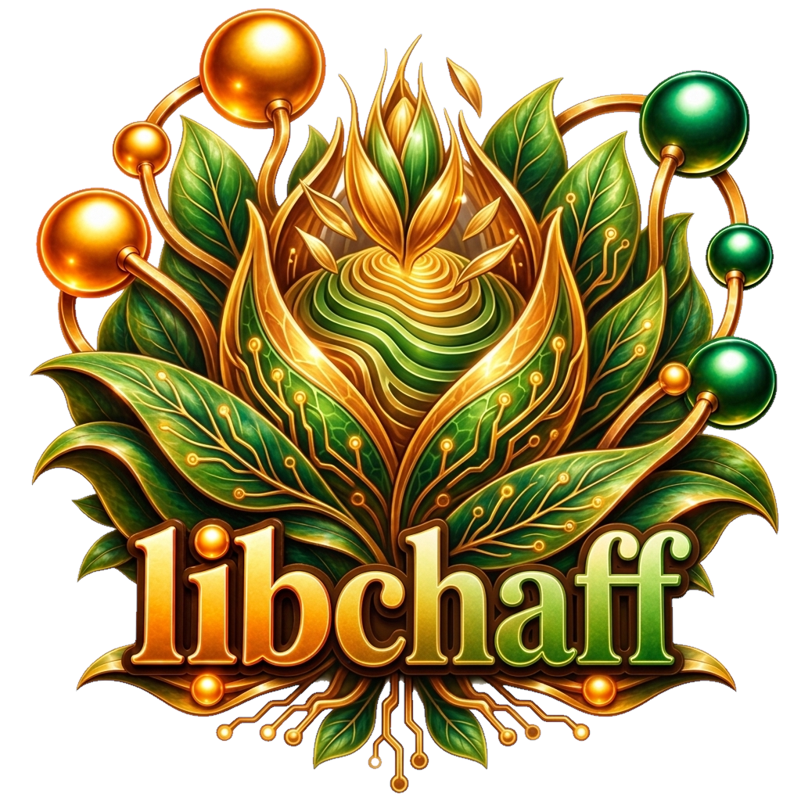

<p align="center">
  
</p>

# @tty-pt/chaff

[](https://www.npmjs.com/package/@tty-pt/chaff)
[](https://github.com/tty-pt/libchaff/blob/main/LICENSE)
[](#)
[](#)
[](#)
[](#)

> Universal Node.js and Browser bindings for **`libchaff`**, the pure-integer N-dimensional procedural noise engine with $C^2$ Hermite smoothstep interpolation, periodic domain wrapping, analytical gradients, and hypercube matrix stepping. Canonical C headers: `<ttypt/chaff.h>`, `<ttypt/noise.h>`, and `<ttypt/chaff_glsl.h>`.

📖 **Full C & Mathematical Documentation**: See the main [**libchaff GitHub README**](https://github.com/tty-pt/libchaff#readme) for the mathematical foundations of recursive noise, forward-difference matrix stepping, analytical surface normals, and GLSL ES 3.0 shader parity.

---

## 1. Overview & Domain Concepts

`libchaff` (`@tty-pt/chaff`) is an ultra-fast, deterministic procedural noise engine engineered for continuous planetary terrain, bathymetry, and 4D spatiotemporal atmospheric fields:

1. **Bit-Exact Pure Integer Core (Zero Floats)**:
   - Operates strictly on integer arithmetic (`-mgeneral-regs-only` on C builds), guaranteeing bit-for-bit identical output across x86_64, ARM64, Node.js N-API, browser WebAssembly, and WebGL2 GLSL ES 3.0 shaders.
2. **$C^2$ Quintic Hermite Smoothstep Interpolation**:
   - Uses Perlin's quintic fade curve ($6t^5 - 15t^4 + 10t^3$) in fixed-point integer math to eliminate slope creases and Mach banding across lattice cell boundaries.
3. **Hypercube Forward-Difference Matrix Stepping (`chaffOctaves` / `noiseOctaves`)**:
   - Precomputes step deltas across hypercube axes so intermediate grid cells are evaluated with single-cycle register additions rather than per-pixel corner hashing (10×–15× faster chunk synthesis).
4. **Analytical Gradients, Slice Stepping & Anti-Resonance FBM (C / WASM)**:
   - Provides $O(1)$ analytical surface normal derivatives (`chaff_sample_grad_2d/3d/4d`), 2D/3D slice stepping across 3D/4D fields (`chaff_fill_slice_3d/4d`), golden-ratio domain rotation (`chaff_fbm_rotated_2d`), and seamless two's-complement toroidal wrapping.

---

## 2. Installation

```bash
npm install @tty-pt/chaff
```

**Native OS Packages (`tty.pt`)**: Prebuilt native C packages (`libchaff`) for Linux (`apt`, `apk`, `pacman`, `dnf`), macOS (`brew`), Windows (`winget`, MSYS2), and OpenBSD (`pkg_add`) are available via the [**tty.pt package repositories**](https://github.com/tty-pt/ci/blob/main/docs/install.md).

---

## 3. Quickstart

```typescript
import {
  chaffPoint1D,
  chaffPoint2D,
  chaffPoint3D,
  chaffPoint4D,
  chaffPointN,
  chaffOctaves
} from "@tty-pt/chaff";

const seed = 0x1337BEEF;

// 1. Continuous 1D / 2D / 3D / 4D point queries (shift = log2 lattice spacing)
const h1 = chaffPoint1D(128, seed, 4);
const h2 = chaffPoint2D(1024, -2048, seed, 6);
const h3 = chaffPoint3D(100, 200, 42 /* time Z */, seed, 5);
const h4 = chaffPoint4D(100, 200, 30, 15 /* time W */, seed, 5);
console.log({ h1, h2, h3, h4 });

// 2. Arbitrary N-dimensional point query
const hn = chaffPointN([12, 34, 56, 78, 90], seed, 4);

// 3. Multi-octave 2D chunk synthesis via forward-difference matrix stepping
//    cy = 5 -> (2^5 x 2^5) = 32x32 = 1024 cells
const heightmap = chaffOctaves(
  2,                // 2D field
  [0, 0],           // chunk origin [x0, y0]
  [
    { x: 5, w: 64 }, // Macro octave: frequency shift 5, weight 64
    { x: 3, w: 24 }, // Meso octave:  frequency shift 3, weight 24
    { x: 1, w: 8 }   // Micro octave: frequency shift 1, weight 8
  ],
  seed,
  5                 // log2 chunk dimension (2^5 = 32)
);
console.log("Generated cells:", heightmap.length, "Origin sample:", heightmap[0]);
```

---

## 4. JavaScript / TypeScript API Reference

### Point Queries
- `chaffPoint1D(x: number, seed: number, shift: number, options?: { wasm?: boolean }): number`
- `chaffPoint2D(x: number, y: number, seed: number, shift: number, options?: { wasm?: boolean }): number`
- `chaffPoint3D(x: number, y: number, z: number, seed: number, shift: number, options?: { wasm?: boolean }): number`
- `chaffPoint4D(x: number, y: number, z: number, w: number, seed: number, shift: number, options?: { wasm?: boolean }): number`
- `chaffPointN(coords: number[], seed: number, shift: number, options?: { wasm?: boolean }): number`
- Backwards-compatible aliases: `noisePoint1D`, `noisePoint2D`, `noisePoint3D`, `noisePoint4D`, `noisePointN`.

### Bulk Multi-Octave Matrix Synthesis
- `chaffOctaves(dim: number, origin: number[], octaves: Array<{ x: number; w: number }>, seed: number, cy: number, options?: { wasm?: boolean }): Uint32Array` (alias: `noiseOctaves`)
  - Synthesizes a $2^{\text{cy}} \times \dots \times 2^{\text{cy}}$ hypercube across `octaves.length` octaves in a single native C or WebAssembly call.

### WebAssembly Reactor Access
- `getChaffWasm(): WebAssembly.Instance` (alias: `getNoiseWasm()`): Returns the initialized `chaff.wasm` reactor instance on `@tty-pt/stele`'s shared linear memory substrate, exposing low-level C exports (`chaff_sample_2d`, `chaff_sample_grad_2d`, `chaff_fill_slice_3d`, `chaff_fill_slice_4d`, `chaff_fbm_2d`, `chaff_fbm_rotated_2d`).

---

## 5. C Development Headers & Native Integration

```makefile
CFLAGS += -I./node_modules/@tty-pt/chaff/include
LDLIBS += -lchaff -lxxhash
```

---

## License

BSD-2-Clause — Copyright (c) 2026, Paulo Quirino <quirinpa@gmail.com>. See [LICENSE](https://github.com/tty-pt/libchaff/blob/main/LICENSE).
